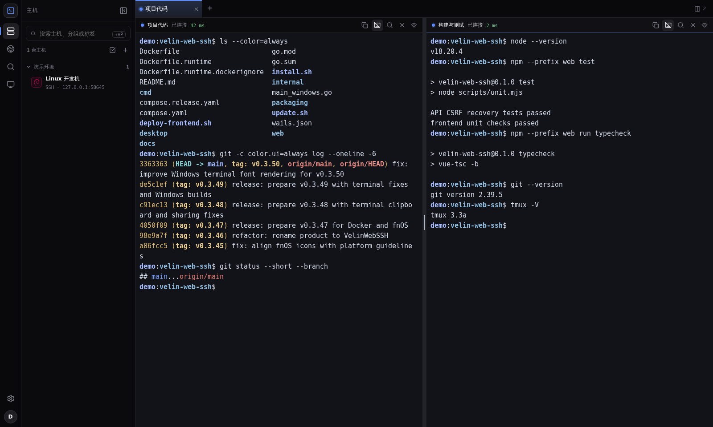

<div align="center">

# VelinWebSSH

**自托管的 SSH 与远程桌面工作区**

主机、终端、文件和内网 Web，一个界面管理。

[](https://github.com/ttyob/velin-web-ssh/actions/workflows/container.yml)
[](https://github.com/ttyob/velin-web-ssh/releases/latest)
[](https://github.com/ttyob/velin-web-ssh/pkgs/container/velin-web-ssh)

[快速安装](#快速安装) · [下载安装包](https://github.com/ttyob/velin-web-ssh/releases/latest) · [使用文档](docs/deployment.md) · [开发指南](docs/development.md)

</div>



<p align="center"><sub>真实运行截图 · SSH 连接与分屏终端</sub></p>

## 功能

| 能力 | 支持 |
| --- | --- |
| **终端工作区** | 多标签、分屏、主题、搜索、tmux 与断线恢复 |
| **主机管理** | 分组、跳板机、OpenSSH 配置导入 |
| **远程桌面** | 网页 RDP / VNC、Windows 本地 RDP |
| **文件与内网** | SFTP、在线编辑、Web 代理、端口转发、Tailscale |
| **会话分享** | 限时链接、密码保护、只读或可操作权限 |
| **运维扩展** | 资源监控、Docker / Git、可选 AI Agent 与专用代理 |
| **安全与备份** | TOTP、PIN 锁屏、主机指纹、加密备份 |

## 快速安装

Linux 需先安装 Docker Engine 和 Docker Compose v2：

```bash
curl -fsSL https://raw.githubusercontent.com/ttyob/velin-web-ssh/main/install.sh | sh
```

安装完成后会显示访问地址和初始管理员账号、密码。默认端口 **8377**，首次登录需修改密码。

升级（默认 root 安装目录）：

```bash
/opt/velin/update.sh
```

普通用户默认安装到 `~/.local/share/velin`。HTTP 内网部署需设置 `VELIN_COOKIE_SECURE=false`；安装权限、Compose 部署与 HTTPS 配置见[安装文档](docs/deployment.md)。

## 选择版本

| 平台 | 获取方式 | 说明 |
| --- | --- | --- |
| **Docker Web** | [容器镜像](https://github.com/ttyob/velin-web-ssh/pkgs/container/velin-web-ssh) | `amd64` / `arm64`，浏览器访问 |
| **飞牛 fnOS** | [下载 `.fpk`](https://github.com/ttyob/velin-web-ssh/releases/latest) | 原生应用，NAS 无需安装 Docker |
| **Windows** | [下载 `.exe`](https://github.com/ttyob/velin-web-ssh/releases/latest) | 单文件桌面版，需要 WebView2 Runtime |

Docker 镜像：`ghcr.io/ttyob/velin-web-ssh:latest`。固定版本可使用对应版本标签，开发构建使用 `edge`。

## 文档

- [安装与配置](docs/deployment.md)：Docker / fnOS / Windows、环境变量、密码重置与备份
- [开发与构建](docs/development.md)：本地开发、测试、打包与发布
- [fnOS 打包说明](packaging/fnos/README.md)
- [问题反馈](https://github.com/ttyob/velin-web-ssh/issues)

升级时请保留数据目录，尤其是 `velin.db` 和 `master.key`；Windows 版数据位于 EXE 所在目录。
