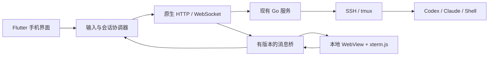

# 手机 App 需求与技术设计

状态：第一版已实现并完成 Android 调试构建，真机验收待完成。日期：2026-10-31。开发前源码核对基线：`e6494f1`。

[开发任务与验收计划](mobile-app-development-plan.md) · [构建与当前限制](../mobile/README.md) · [界面截图](../mobile/design/README.md) · [开发指南](development.md)

## 1. 产品目标

提供专门为手机设计的开发客户端。App 负责会话管理、阅读输出、输入需求、上传附件和查看开发结果；Go 服务负责认证、SSH 与会话转发；远端 Linux 上的 tmux 持续运行 Codex、Claude Code、Shell 和开发命令。

核心体验：在电脑上开始开发，离开后用手机打开同一会话，查看进展、补充需求或处理交互；手机锁屏、切换应用或被系统回收后，服务器上的任务继续运行，重新进入 App 可以恢复。

用户已确认外网访问由现有内网穿透解决。App 只接入用户提供的服务地址，本计划不包含内网穿透、VPN、域名或公网部署功能。

## 2. 方案与范围

### 2.1 已确定的技术方案

- 手机界面：使用 Flutter，统一实现 Android / iOS 的会话页、输入面板、文件选择和设置。
- 终端区域：独立的本地 WebView 页面，内嵌 xterm.js，负责 ANSI、光标、颜色、选择和终端模式解析。
- 网络层：App 统一管理 HTTP、WebSocket、Cookie、重连和上传，终端 WebView 通过有版本的消息桥收发数据。
- 后端：复用现有 Go 服务及 SSH / tmux 能力，以少量可关闭的扩展补齐手机接入需求。
- 项目组织：客户端集中放在 `mobile/`，独立依赖、构建和发布；新增后端适配集中在单独文件中。

用户已确认使用 Flutter，并要求界面具有完整的视觉设计。具体依赖版本在 M0 验证后锁定。xterm.js 首轮验证沿用当前项目的 `5.5.0`，不同时升级终端内核。

### 2.2 平台安排

需求同时覆盖 Android 和 iOS。Android APK 优先做技术验证和内部试用是暂定顺序，用户尚未指定主要手机平台。iOS 真机、签名及分发方式在对应构建任务开始前确定；未完成 iOS 验证时，不宣称双平台可交付。

### 2.3 优先级

| 级别 | 交付内容 |
| --- | --- |
| P0：首个可用版本 | 服务登录、主机与会话列表、tmux 创建与恢复、终端查看和接管、多行输入、快捷键、触控滚动复制、图片与文件上传、生命周期恢复、设备独立设置 |
| P1：开发操作增强 | Git 改动与 Diff、轻量文本编辑、开发网页预览、最近项目入口、外接键盘完整适配、系统分享入口 |
| P2：可靠事件与通知 | 基于 CLI 明确事件的完成、失败、等待确认通知；接平台推送后评估离线提醒 |

首版聚焦远端 Linux + tmux。普通 SSH 可作为兼容入口，但应说明其恢复能力；不自动安装 tmux，缺少时提供安装说明和手动选择。RDP / VNC、全套桌面管理功能、独立 AI 工作流、会话观察与 AI 摘要不属于本计划首版范围。

## 3. 现有能力与实际缺口

| 能力 | 已有事实 | 手机端需要补充 |
| --- | --- | --- |
| 登录与账户 | Cookie 会话、CSRF、验证码、TOTP、首次改密、PIN 锁屏 | 原生页面完整接入，统一 Cookie 存储和错误恢复 |
| 主机与会话 | 查询、创建、恢复、改名、终止 | 手机列表、收藏与最近使用、明确的关闭语义 |
| 终端输出 | WebSocket、流标识与字节偏移、分段重放、重放预览 | 原生桥接顺序、流量控制、冷启动重建与重放去重 |
| 输入控制 | 请求、批准、释放控制权 | 默认查看接入方式；现有普通订阅可能自动取得空闲控制权 |
| 输入送达 | 现有 `input` 消息写入终端 | 目前没有输入编号、确认回执和重复发送防护 |
| 终端尺寸 | 控制者可发 `resize` | 同步远端实际网格及版本；只读手机不得自行改变远端尺寸 |
| 历史浏览 | 普通缓冲区与 tmux 历史协议 | 触控手势；tmux 远端历史操作目前要求控制权 |
| 文件附件 | 当前目录查询、创建目录、SFTP 上传 | 系统文件选择、进度与取消、路径插入、切换会话后的归属校验 |
| 文件编辑 | 文本读取、版本校验写入，当前上限 2 MiB | P1 手机编辑页面和冲突处理 |
| Git | Web 界面通过远端命令执行 Git | P1 提取执行与解析逻辑；当前没有独立 Git REST 接口 |
| 开发预览 | 内网 Web 服务及代理入口 | P1 独立预览页面和返回会话流程 |

依据：[HTTP 与终端协议](../internal/api/api.go)、[会话管理](../internal/terminal/manager.go)、[文件接口](../internal/api/sftp.go)、[Web 终端](../web/src/components/TerminalPane.vue)、[Git 界面](../web/src/components/GitDialog.vue)。

## 4. 页面与操作流程

### 4.1 服务与登录

输入服务地址，显示可访问状态和客户端所需能力；支持保存多个服务档案，一次连接一个服务。档案按地址和账户隔离，切换服务时先退出当前终端连接。

登录需处理用户名密码、图形验证码、TOTP / 恢复码、首次修改密码、账户禁用和会话失效。PIN 锁屏后按已有服务端规则解锁。页面显示可理解的错误和重试入口，不将具体连接失败隐藏为无响应。

### 4.2 会话首页

- 默认展示已有会话，按最近使用排序，支持搜索、改名、收藏、恢复。
- 另设主机入口，选择主机后立即进入连接页面，进度、指纹确认、失败原因均在页面中展示。
- 项目首先是“服务 + 主机 + 目录 + 启动命令”的快捷入口，不创建新的工作流执行系统。
- 新建会话可填写名称和目录；已有会话通过服务端 session ID 关联，避免手机重复创建同名任务。
- “退出终端页面”保留远端任务；“终止远端会话”是独立动作，说明影响并确认。失败也允许离开页面，保留可重试记录。

### 4.3 终端页面

一次展示一个终端，返回会话列表切换。主要区域用于输出；底部为 48 像素工具条，输入默认收起，展开后替换工具条。主机在首页顶部切换，设置、筛选及其他低频操作进入菜单或底部面板。配色使用黑灰、冷白与少量灰蓝。

```text
┌──────────────────────────┐
│ 返回  会话名称  查看/接管  ⋯ │
├──────────────────────────┤
│                          │
│       xterm.js 输出       │
│                          │
│                  回到底部 │
├──────────────────────────┤
│ 输入  Esc Ctrl+C 选择 键 全屏│
└──────────────────────────┘

展开输入后，底栏替换为：
│ 收起  [输入需求……  ＋]  ↑ │
```

“＋”包含附件、只粘贴正文、展开长文本与完整快捷键。选择模式底栏提供退出及复制。全屏隐藏上下栏，保留退出全屏入口。线框为布局示意，实际截图见 `mobile/design/`。横屏仍以单终端为默认视图，首版不复刻桌面分屏。

### 4.4 查看与接管

已有会话默认以“查看”进入；进入页面本身不取得控制权，也不发送远端尺寸变化。点击“接管”走现有控制权请求流程；电脑端正在控制时等待明确响应，不静默抢占。

获得控制权后才允许输入、远端快捷键、改变远端尺寸或进入会改变 tmux 视图的历史模式。控制权变化立即反映在页面；失去控制权时保留本地草稿并停止发送。

“查看”是会话的输入控制模式，不是账户权限：上传、终止等操作仍需原有账户授权，并通过明确的用户动作发起。

### 4.5 关闭与恢复

退出页面、退到后台、退出账户、终止会话分别处理。前两者不终止远端 tmux；退出账户清除本地认证信息；终止操作展示服务端实际结果，包括远端未成功终止的情况。

客户端失联不能被标记为开发任务失败；终端安静不能被标记为开发任务完成。

### 4.6 视觉设计与页面开发顺序

界面质量作为 P0 交付要求。页面开发前先完成视觉规范、关键页面高保真稿与交互原型；终端桥接等技术验证可同时推进。当前线框只表达功能布局，不能作为最终视觉稿验收。

建议风格为克制、清晰的开发工具：以深灰层次区分背景与操作区域，使用一种主强调色，保持终端内容清晰可读。具体色值在设计稿阶段确定；手机外壳配色与终端主题分别定义，均遵守设备独立设置规则。

| 设计项 | 要求 |
| --- | --- |
| 页面结构 | 会话首页突出最近会话和继续操作；终端页为输出保留主要空间，低频操作进入菜单或底部面板 |
| 字体与间距 | 建立统一字号、字重和行高；界面正文以 14～16 逻辑像素、标题以 20～24 为起始参考，按系统字体缩放验证；采用 4 / 8 间距体系、常规左右边距 16，终端区单独设计 |
| 组件 | 为按钮、列表行、状态标签、输入框与底部面板定义统一外观及交互状态；Material / Cupertino 组件按同一设计规范调整 |
| 颜色与层次 | 控制边框、阴影、圆角的数量与强度；正文对比度以至少 4.5:1 为目标，关键状态同时使用文字或图标表达 |
| 会话列表 | 统一标题、主机 / 目录摘要、连接与控制状态的层级；长名称可辨识，目录支持截断和查看完整内容 |
| 终端与输入 | 顶栏、快捷键条、输入面板与终端边界协调；键盘开合时保持视觉连续，发送与粘贴可区分且易触达 |
| 反馈与动效 | 明确按下、禁用、等待、成功与失败状态；过渡简短，不遮盖新输出，尊重系统减少动态效果设置 |

M0 设计交付至少包括：服务登录、会话列表、终端查看、终端接管输入、选择复制、附件上传六类场景；终端页需覆盖键盘展开 / 收起。空列表、连接中、连接失败、控制权等待和长文本也必须有对应状态稿。

设计稿、交互原型和视觉规范集中保存于 `mobile/design/`，记录尺寸及版本。实现后以相同尺寸截图对照，检查层级、间距、字形、截断和状态；360 / 390 / 430 逻辑像素宽度、横屏及系统字体放大场景均纳入验证。图片好看不能替代真实终端与系统键盘验收。

## 5. 功能需求

| 编号 | 优先级 | 要求与验收重点 |
| --- | --- | --- |
| MOB-01 | P0 | 原生服务配置及完整登录流程，重启 App 后按账户策略恢复认证 |
| MOB-02 | P0 | 主机、会话列表及当前连接进度；重复点击不会重复创建会话 |
| MOB-03 | P0 | tmux 创建、恢复、改名和显式终止；失败会话也可离开与清理 |
| MOB-04 | P0 | 本地 xterm 页面显示真实 SSH 输出，兼容 Shell、Codex、Claude Code |
| MOB-05 | P0 | 默认查看、明确接管；手机不会因打开页面而改变电脑控制权或终端尺寸 |
| MOB-06 | P0 | 多行原生输入、中文输入法、草稿保存；组合输入期间不误发送 |
| MOB-07 | P0 | 快捷键与两种发送动作，输入不因连点、重连或回执丢失而自动重复 |
| MOB-08 | P0 | 手指按行浏览历史、回到底部、选择复制；支持远端 TUI 的滚动与点击 |
| MOB-09 | P0 | 软键盘、安全区域、横竖屏适配，发送按钮始终可触达 |
| MOB-10 | P0 | 锁屏、切后台、网络切换、系统回收后恢复；草稿和远端任务保留 |
| MOB-11 | P0 | 系统选择图片 / 文件，上传到远端项目的 `clipboard/` 并插入引用 |
| MOB-12 | P0 | 手机字号、主题、视图与草稿独立保存；不覆盖桌面 workspace 与字体偏好 |
| MOB-13 | P1 | Git 状态和单列 Diff，处理长行、二进制文件、重命名和大文件 |
| MOB-14 | P1 | 轻量文本编辑，保存使用已有版本校验；冲突时保留本地内容 |
| MOB-15 | P1 | 打开现有开发预览入口，返回终端保持会话与草稿 |
| MOB-16 | P1 | 外接键盘组合键、系统分享文件到 App、项目快捷入口 |
| MOB-17 | P2 | 有明确事件来源后提供任务提醒，分别展示事件来源、任务与时间 |
| MOB-18 | P0 | 先完成手机视觉规范与关键页面设计，实现按稿对照验收；覆盖窄屏、键盘、字体放大及异常状态 |

### 5.1 输入规则

默认使用 App 的多行输入框，系统语音输入通过输入法完成，不另建语音识别服务。草稿按服务、账户和会话隔离。

- “粘贴”：把文本送入当前终端编辑区，不追加提交键。
- “发送”：按远端粘贴模式发送正文，再追加一次提交键。
- 输入框内回车只换行；中文候选确认、组合输入和附件选择不会触发发送。
- xterm 解析远端 bracketed paste 模式并报告给 App。远端未启用该模式时，多行正文提示其可能成为多条命令，由用户明确选择处理方式。
- 原生输入框与 xterm 隐藏输入元素保持单一输入来源；同一个按键不能同时经两个通道发送。
- 含 Tab、换行或控制字符的剪贴板内容不能静默变为快捷键序列。只有专门快捷键按钮发送对应控制字节。
- 提交期间禁用重复点击。断线后保留草稿及“未确认”记录，不自动再次发送用户输入。
- 首版单次正文暂定上限 48 KiB UTF-8，保证 Base64 和 JSON 封装后低于现有 128 KiB WS 入站消息上限；超过时建议以文件上传，后续再设计分段发送。

终端回执最多说明字节已写入 SSH 通道，不代表 CLI 已理解、执行成功或任务完成。

### 5.2 历史、触控与复制

提供“浏览”和“选择”两种明确模式。浏览模式下手指滑动控制历史；选择模式下拖动选择文本并显示复制按钮，暂停自动跟随。新输出到来时提示“有新输出”，点击回到底部才重新跟随。

复用现有普通缓冲区、tmux 历史与应用鼠标协议，按实际终端模式分派事件。滚动按行累计，禁止一次手势默认跳一整页。TUI 按钮点击需转换成准确的终端行列，不把浏览手势当作远端点击。

只读手机可查看本地已正确构建的内容。当前远端 tmux 历史操作会改变共享视图并要求控制权，需提示接管后浏览；不可承诺只读模式能独立遍历全部远端历史。若以后提供独立只读历史快照，应另行设计且验证其不干扰电脑会话。

保留 xterm 的备用屏幕和原始控制序列，禁止通过拼接纯文本、禁用备用屏幕等方式修补 TUI 历史。

### 5.3 键盘、尺寸与字体

优先采用系统键盘可视区域和 WebView 实际布局尺寸。输入面板位于键盘上方，适配刘海、底部手势区和横竖屏；常用按钮目标区域按 Android 48 dp / iOS 44 pt 设计。

软键盘开合优先改变本地可视区域，避免每次动画都触发远端 resize。查看模式按服务器报告的网格渲染，可横向浏览；接管后可选“适配手机”，稳定布局后合并发送一次有效 resize。

手机字号和配色在本地保存。中英文混排、宽字符、Emoji、框线及不同屏幕密度必须真机验证，不用 CSS 拉伸字形补偿。DOM / Canvas 渲染选择由 M0 字形与性能验证决定。

### 5.4 附件与远端目录

附件流程：选择文件 → 查询目标会话当前目录 → 确认上传位置 → 创建 `clipboard/` → 上传并检查偏移 / 大小 → 把路径插入草稿 → 用户发送。

- 路径指向远端项目目录下的 `clipboard/`，不默认落到远端根目录或服务端工作目录。
- 无法获取目录时要求选择或填写远端绝对目录，不猜测当前项目路径。
- 使用唯一文件名，过滤路径分隔符与控制字符，正确转义空格、引号和中文路径。
- 上传固定绑定发起时的 host ID、session ID 与目录。切换会话后不自动把路径插入另一个终端。
- 展示进度、取消和失败原因。服务端上传失败可能删除不完整文件，重试前查询实际状态，不能盲信本地偏移。
- App 临时文件在上传结束或取消后清理；远端文件保留到用户主动清理。首版不做自动删除历史附件。
- 图片以远端文件引用交给 CLI，不依赖远端 X11 剪贴板；上传成功不等于特定模型支持图片，需要对目标 CLI 实际验证。

## 6. 技术架构与模块边界



当前隔离目录：

```text
mobile/
  app/                    Flutter 客户端、平台工程与测试
  terminal/               xterm 页面、主题、输入模式与桥接适配
  contracts/              桥接协议、移动扩展协议、样例与测试用例
  scripts/                终端资源打包、客户端构建与校验
internal/api/mobile.go    移动扩展路由、能力声明和适配（本次新增）
internal/terminal/mobile.go
                         查看订阅、尺寸同步、输入回执（本次新增）
```

WebView 只加载随 App 打包的终端资源，不加载 `/workspace` 作为主界面。会话页、登录、文件选择和输入面板由手机客户端实现。不得将整份 `TerminalPane.vue` 复制到 App 后分别修复；将可复用的协议处理拆为无 Vue 依赖的模块，提取时用既有终端回归保护 Web 端。

App 构建不加入 Docker / fnOS / Windows 的默认构建链。新增后端能力由独立入口注册，关闭或删除 `mobile/` 后，原有 Web 与桌面构建应继续通过。

### 6.1 网络与认证

原生网络层维护一个按服务档案隔离的 Cookie 容器：先获取 `/api/csrf`，再执行登录；写请求携带匹配的 CSRF Cookie 和 `X-CSRF-Token`，WS 握手携带该档案的认证 Cookie。Cookie 名称和过期时间以实际响应为准，兼容 HTTP / Secure 配置，不硬编码某一个名称。

原生网络层负责 WS 握手的服务地址与 Origin 处理，保留现有同源校验和 CSRF 防护。终端 WebView 不直接跨域请求服务端，也不向其注入会话 Cookie、密码或模型 Key。

登录态保存在系统安全存储；密码默认不持久保存。注销和删除服务档案清理认证、连接与对应本地缓存。服务证书或访问策略错误显示给用户，不通过忽略证书错误解决连接问题。

`csrf_rejected` 只允许刷新安全令牌后按受控条件重试一次；登录过期进入登录流程。用户输入发送、创建会话等可能有副作用的操作，不能使用通用无限重试策略。

### 6.2 原生与终端消息桥

协议至少包含 `version`、`type`、`sessionID` 和页面实例 `generation`。每次重建 WebView 产生新 generation，丢弃旧页面的迟到事件。

| 方向 | 主要消息 | 用途 |
| --- | --- | --- |
| 原生 → 终端 | configure / reset / write / setViewport / setSelectionMode / dispose | 配置、重放输出、布局与释放 |
| 终端 → 原生 | ready / rendered / input / selection / modes / geometry / link / bell | 渲染完成、输入意图、选择与模式变化 |

数据用结构化 JSON 与 Base64 字节传递，不将远端输出拼成可执行 JavaScript。UTF-8 分片直接交给 xterm 字节写入，避免跨帧中文被错误解码。

原生层验证输入所属会话、当前控制权和页面 generation 后才写入 WS。处理链接、剪贴板等终端请求需用户可见操作；开发预览页面不挂接终端消息桥。

### 6.3 输出顺序与恢复

应用状态分别维护：连接状态、控制权状态、重放状态、输入送达状态。不能用一个“运行中”同时表达这些含义。

现有协议的 `streamID` 与 `offset` 表示原始输出流和字节位置。重放、实时输出、预览的处理规则以现有实现为依据：

1. WS 连接后处理 `hello`，确认流、状态与控制者。
2. 区分 `replay_preview`、`replay`、`replay_live`、`replay_end` 和正常 `output`；预览不得再次当作正式历史追加。
3. `rendered` 回调后才推进对应渲染器的已应用偏移；收到 WS 数据不等于已经应用到 xterm。
4. 同一流重复数据去重，发现缺口、流改变或 `truncated` 时进入重新同步并说明历史边界。
5. App 保留活动渲染器时可按已应用位置续传；WebView 被回收后，旧 offset 不能恢复丢失的终端状态，必须完整重放或从一致快照恢复。
6. 远端终端网格变化需与重放边界匹配；在 M0 证明状态与尺寸恢复可靠前，不以静态截图替代完整同步。

现有输出缓冲区为每会话至多 64 MiB 的内存环形缓冲，不是永久日志。服务器重启、截断和普通 SSH 结束都必须显示实际可恢复范围。tmux 保存远端进程，不等于保留无限历史或保证恢复全部历史画面。

原生到 WebView 采用有上限的写队列与分批写入，避免高频输出阻塞界面；不能静默丢字节。达到队列上限时停止追加并进入可解释的重新同步流程。具体队列大小由 M0 压测确定并固化为配置与测试。

### 6.4 生命周期与本地状态

退后台时保存草稿、当前会话、渲染同步信息并释放控制权；Android / iOS 均按可能暂停进程处理。回到前台先检查认证和真实连接状态，再恢复会话；网络变化与连续前后台切换只能触发一个有效重连流程。

不设置手机端“AI 任务最大运行时间”。请求超时仅针对通信，远端 tmux 任务独立运行。连接恢复后不自动再次执行启动命令，也不自动重发输入。

设置、草稿、最近会话按服务和账户命名空间保存；不通过 `/api/workspace` 改写桌面布局，不把移动字号写回全局 `/api/preferences`。首版不在本地持久化完整终端日志，本地缓存有容量上限和清理入口。

## 7. 接口复用与拟新增协议

本节记录设计要求；本次工作区已实现 EXT-01～04，实际字段和边界见 [移动协议 v1](../mobile/contracts/README.md)。本机 Docker 服务已在 2026-10-31 更新并验证这些能力；其他旧部署仍需升级。

### 7.1 直接复用

| 用途 | 现有接口 |
| --- | --- |
| CSRF、登录、账户与改密 | `/api/csrf`、`/api/auth/login`、`/api/auth/me`、`/api/auth/password` |
| 验证码与 PIN | `/api/auth/captcha`、`/api/auth/lock`、`/api/auth/unlock`、`/api/auth/lock-pin` |
| 主机与连接测试 | `/api/hosts`、`/api/hosts/{id}/test` |
| 会话管理 | `/api/sessions`、`/api/sessions/{id}/restore`、`/api/sessions/{id}` |
| 终端数据 | `/ws/sessions/{id}`，已有流位置、重放、历史和控制权消息 |
| 当前目录与文件 | `/api/sessions/{id}/directory`、`/api/sftp/{hostID}/mkdir`、`/api/sftp/{hostID}/upload` |
| P1 编辑与预览 | `/api/sftp/{hostID}/text`、`/api/web-services`、`/api/web-services/{id}/open` |

### 7.2 首版必须解决的扩展

| 编号 | 拟设计 | 原因与约束 |
| --- | --- | --- |
| EXT-01 | `GET /api/mobile/v1/capabilities` | 声明移动协议版本、查看订阅、终端尺寸和输入回执能力；版本号之外按能力判断兼容性 |
| EXT-02 | 显式查看订阅，例如 WS `attach=view` | 允许后续明确申请控制，但连接本身不自动取得控制权；不能直接复用永久禁止控制的分享订阅实现接管 |
| EXT-03 | 终端网格元数据与变化事件 | 提供 rows、cols 和尺寸版本；查看者按实际网格渲染，控制者仍走原有 resize 校验 |
| EXT-04 | 可选输入编号与 `input_ack` | 对 App 输入确认写入结果，并在有限范围内防止重复写入；旧 Web 消息行为保持兼容 |

EXT-02 应单独控制“允许申请控制”与“连接时自动申请”两个行为。原有 Web 连接未声明手机模式时保持现状，所有写入、resize、远端鼠标与 tmux 历史操作仍由服务端检查控制权。

EXT-04 的去重键需绑定账户、session、客户端与 input ID；约定条目容量、有效期、并发写入及部分写入失败语义。同一有效条目重复请求不能再写终端；过期或服务器重启后不能承诺去重。回执含“全部写入 / 拒绝 / 结果不确定”等结果，不等同于命令执行状态。即使具备去重，首版也不自动重发断线期间的输入。

能力接口不可用或关键能力缺失时，App 显示所需服务端升级提示。禁止用“先连接取得控制、再释放”的方式模拟默认查看。现有服务器基线不代表已满足 App 首版最低版本要求。

## 8. 性能与兼容目标

以下为开发验收目标，不是已经测得的结果；M0 需要记录设备、网络和样本后调整并冻结：

- 360 / 390 / 430 dp 宽度下，常用操作无页面横向溢出；终端宽内容可在自身区域横向浏览。
- 正常网络下，本地输入与点击在 100 ms 内获得视觉反馈；服务端接管、上传等等待过程有状态提示。
- 连续 30 分钟交互不发生持续内存增长；持续高频输出时仍可操作返回、暂停跟随和切换会话。
- 真机长任务至少运行 4 小时，覆盖锁屏、切后台、Wi-Fi / 移动网络切换，任务不会因客户端退出而被终止。
- 真机覆盖 Android 中文输入法与 iOS 中文输入法，系统回收后的冷启动恢复列为必测。
- CLI 以实际安装版本记录兼容结果；不把 Codex / Claude 的终端界面解析为通用聊天消息协议。

## 9. 后续开发操作与通知

P1 的 Git、文件编辑和预览作为独立页面，不占用活动 CLI 的标准输入来执行辅助命令。Git 需要明确独立命令执行通道、工具依赖与结构化错误；不能假定当前已有 Git REST 接口。文本保存沿用版本校验与冲突提示，Git 写操作需明确用户动作。

预览使用现有服务返回的入口和相应授权，在独立 WebView 中打开。预览页面不能调用终端消息桥，也不将登录 Cookie 复制给任意第三方地址。

P2 仅在 CLI hooks、结构化协议或可验证进程事件提供依据后定义完成、失败、等待确认。终端 bell 可作为交互提示，但不视作任务完成。系统后台通知依赖服务端事件与推送投递链路，不靠 App 常驻 WS 保活；不以“输出变少 / 停止”推断执行结果。

## 10. 开发前待定事项

| 项目 | 当前处理方式 | 决策节点 |
| --- | --- | --- |
| 主要手机平台与最低系统版本 | Android API 24 优先；iOS 暂设 13.0 | 目标真机与 iOS 支持范围待验收 |
| Flutter / WebView 依赖版本 | 技术验证后锁定 | M0 完成 |
| 终端渲染方式、桥接队列与尺寸恢复 | 以中文、真实 TUI 和高输出场景验证 | M0 完成，未通过则停止扩展 UI |
| App 名称、包名、签名与分发渠道 | 不写入现有正式 Release 工作流 | M3 内测构建前 |
| 输入回执与移动扩展字段 | 以草案为起点，需兼容 Web 端 | M0 协议评审并固化 |
| Git 执行通道及 CLI 事件来源 | 分别属于 P1、P2，单独验证 | 对应阶段开始前 |

后续实现、任务状态与测试结果以[开发任务与验收计划](mobile-app-development-plan.md)更新；本需求文档只记录产品要求与设计决策。
