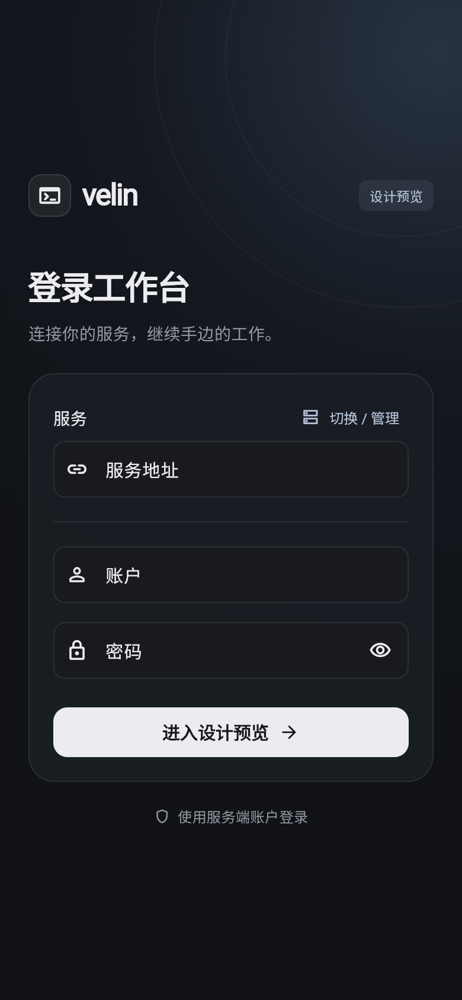
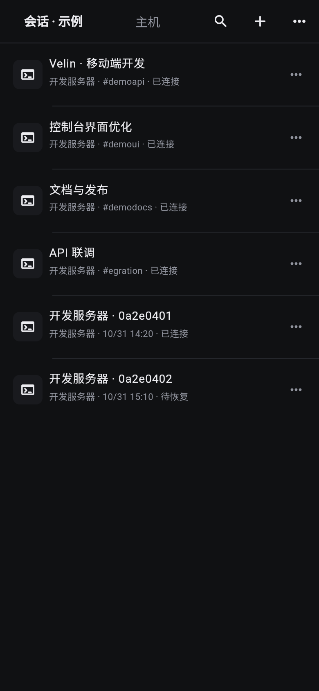
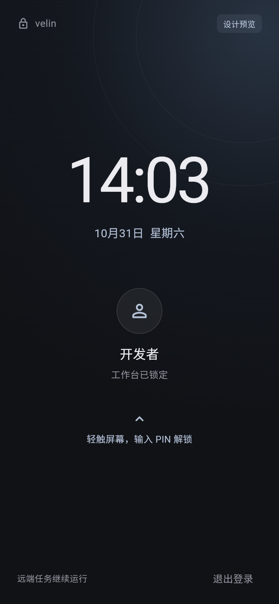
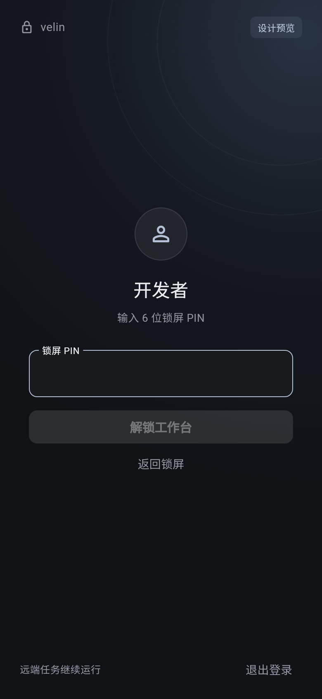
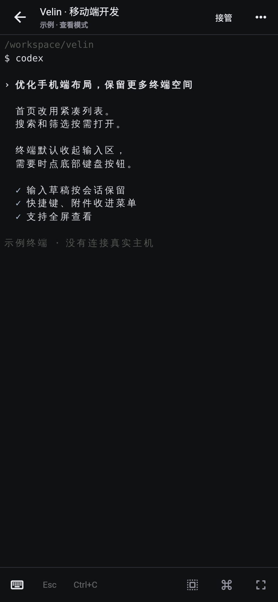
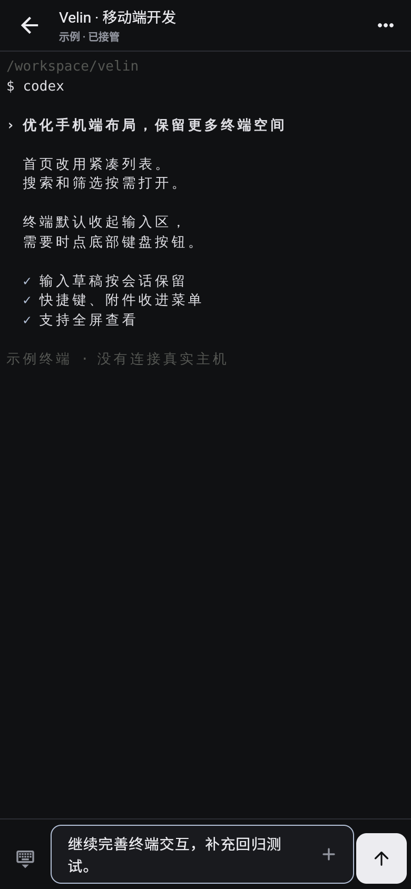
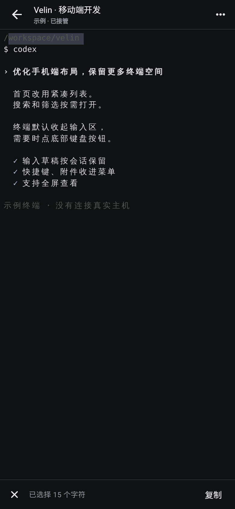
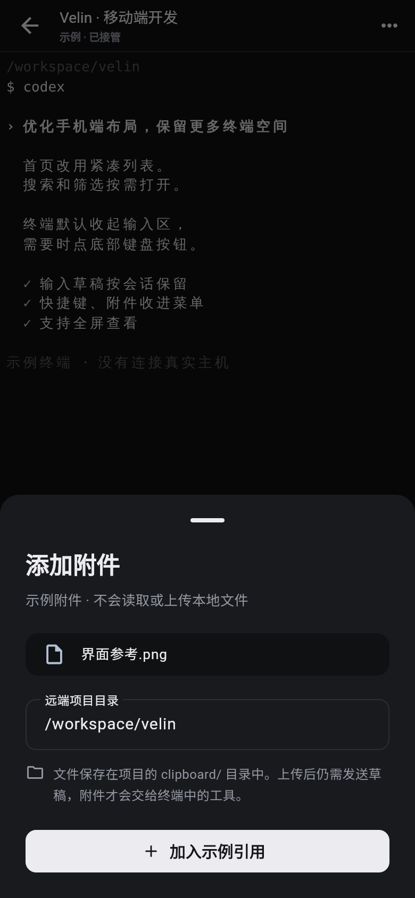

# 手机界面规范与实现截图

黑灰背景、冷白文字和少量灰蓝强调色。首页使用紧凑列表，终端默认收起输入框；搜索、筛选、附件与完整快捷键按需打开。界面与终端字号、颜色分别设置，手机偏好不覆写电脑设置。

以下是 **Flutter 实际运行的浏览器预览截图**，390 × 844 逻辑像素、2 倍像素密度，截图数据为明确标注的示例。不是设计合成图，也不代表 Android / iOS 真机验收；没有模拟系统键盘。

| 登录 | 会话 |
| --- | --- |
|  |  |

| 系统式锁屏 | 展开 PIN |
| --- | --- |
|  |  |

[首次账户设置](screenshots/account-setup.png)与登录共用背景、品牌、面板及输入样式。锁屏默认只展示时间、日期和账户，轻触后展开 PIN；返回收起并清空输入。遮罩覆盖根导航，隐藏底层内容并阻止点击、键盘及无障碍访问，解锁后保留原页面和草稿。

| 终端查看 | 原生输入面板布局 |
| --- | --- |
|  |  |

| 选择模式 | 附件目录确认 |
| --- | --- |
|  |  |

[终端全屏截图](screenshots/terminal-fullscreen.png)

管理页面：[SSH 主机编辑](screenshots/host-editor.png) · [反向代理列表](screenshots/web-services.png) · [反向代理编辑](screenshots/web-service-editor.png) · [服务地址管理](screenshots/service-profiles.png)。

## 设计取值

| 用途 | 当前值 |
| --- | --- |
| 页面背景 | `#101113` |
| 面板 / 抬升底色 | `#191A1E` / `#23252A` |
| 分隔线 | `#2C2E34` |
| 正文 / 次要文字 | `#ECECF0` / `#92959F` |
| 主操作 / 灰蓝强调 / 危险操作 | `#ECECF0` / `#B3C0D6` / `#E2A2A8` |
| 正文字号 | 14～15，辅助 11～13，标题 20～24 |
| 间距 | 4 / 8 基础，列表左侧 16，终端 6 |
| 圆角 | 输入 / 按钮 10，底部面板 18 |
| 触控 | 常用按钮最小 48 逻辑像素 |

会话页使用 52 像素顶部栏和约 76 像素列表行，移除大标题和底部导航。会话 / 主机在顶部切换；搜索按需展开，筛选、刷新和设置收入右上角菜单。

0.1.2 补充主机增改、服务地址与反向代理管理，均从主机“＋”或首页“⋯”打开；高级参数折叠。主机名作为会话名时附带短编号，列表同时展示创建时间；新建会话先填写任务名称。

终端默认查看，顶部保留接管及简短状态；详细连接信息点标题查看。顶部栏与底部工具条各 48 像素，底部只保留输入、Esc、Ctrl+C、选择、快捷键和全屏入口。输入框展开后替换工具条，附件及长文本选项收入输入框的“＋”。收起输入保留草稿；选择时工具条切换为退出 / 复制；全屏隐藏上下栏。

## 复现与待验收

依照 [构建说明](../README.md) 启动预览后运行 `node mobile/scripts/capture-design.mjs`。脚本检查搜索、草稿收展、选择、附件引用、全屏及 360 / 390 / 430 宽度和横屏布局，同时检查浏览器异常。图标源为 [icon.svg](icon.svg)，各平台使用同一终端图形。

`node mobile/scripts/test-management.mjs` 检查主机增改、命名会话、同名区分、反向代理增改 / 打开 / 删除和服务档案增改，并更新上述管理页面截图。预览操作只修改示例数据或当前浏览器的本地档案。

`node mobile/scripts/test-auth.mjs` 更新登录、首次改密、锁屏和 PIN 截图，检查默认收起、错误 PIN、成功解锁、再次锁定及窄屏 / 横屏布局。预览使用固定示例 PIN，真实 App 的认证和 PIN 校验仍由原服务端负责。

后续需补充真机键盘展开 / 收起、系统字体放大、窄屏长标题、断网、指纹和凭据提示截图。系统键盘、字体、剪贴板、文件选择与生命周期均以真机结果验收。
